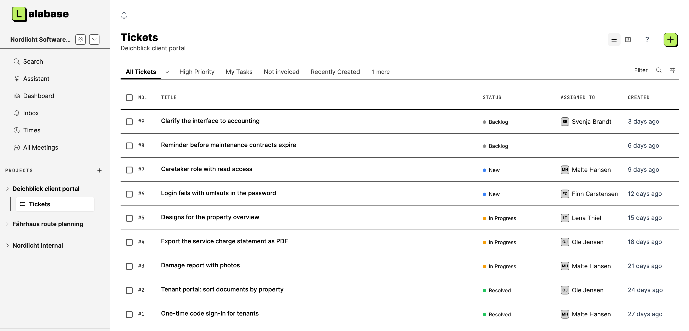

# Lalabase

**Self-hosted project management for software agencies, with an AI assistant that answers from
your own project data and cites its sources.** Tickets, time tracking, docs and meetings in one
place. Bring your own AI model, or leave the AI switched off. Free on your own server, or hosted
by us in Germany.

**[Try the live demo](https://demo.lalabase.com)**: no sign-up, the login is on the page, and
everything resets every night.

[Website](https://lalabase.com/en) · [Self-hosting](https://lalabase.com/en/self-hosting) ·
[Documentation](https://lalabase.com/docs/en/self-hosting/getting-started/overview) ·
[Cloud pricing](https://lalabase.com/en/pricing) · [Changelog](CHANGELOG.md)

<picture>
  <source media="(prefers-color-scheme: dark)" srcset=".github/readme/lala-assistant-dark.svg">
  
</picture>



In production for customers since September 2025. This repository starts with the first public
release, 2026.10.0; [more under Status](#status).

## What it does

- **Clients and projects.** One organisation per client, any number of projects below it.
  Clients get their own access, and roles decide what they see.
- **Tasks.** As a list or a board, with the statuses, priorities and fields you define per
  project.
- **Time tracking.** Several sessions per ticket, each one billable on its own, with exports
  for the invoice.
- **Documentation.** Notes and documents in the project, and a folder in your GitHub or GitLab
  repository becomes the project's docs.
- **Meetings.** Transcript, AI summary and the tasks that follow from it.
- **AI assistant.** One question across tickets, docs, time and meetings, answered with its
  sources. Other AI tools reach the same data through an MCP server and a REST API.
- **Your choice of AI.** OpenAI, Anthropic, Google Gemini through Vertex AI in the EU, Mistral,
  IONOS, OVHcloud, or any OpenAI-compatible endpoint, including a model in your own network.
  The AI stays off until you switch it on.

## Who it is for

Software agencies, freelancers and small software companies that work on projects for clients
and want their project data, and the AI that works on it, under their own control. Lalabase
replaces the usual mix of ticket tool, wiki, time tracking, chat and reporting spreadsheets.

Most teams come from Redmine, Jira, OpenProject, Asana or spreadsheets. The website
[compares Lalabase with each of them](https://lalabase.com/en/comparison), starting with what
the other tool does well.

## Two ways to run it

| | Your own server | Our cloud |
|---|---|---|
| Cost | Free under AGPL-3.0. You pay for the server. | Monthly, see [pricing](https://lalabase.com/en/pricing) |
| Operation, updates, backups | You | Us, hosted in Germany, with a DPA |
| Features | All of them, with each release | All of them, always current |
| AI | Your own key or your own model | The provider you choose |

### Self-host with Docker

You need a server with at least 2 vCPU, 4 GB RAM and 20 GB disk, Docker 24 or later with
Docker Compose v2, and a domain pointing at it.

```bash
git clone https://github.com/lalabase/lalabase.git && cd lalabase
git checkout "$(git describe --tags --abbrev=0)"   # the latest release, not main
cp .env.docker.example .env      # fill in the values it asks for
docker compose up -d --build
docker compose exec web bin/rails lalabase:setup
```

`compose.yml` starts the application, a job worker, PostgreSQL with pgvector, Valkey and Caddy,
which fetches a TLS certificate for `LALABASE_HOST`. If a proxy of your own terminates TLS, drop
the `COMPOSE_PROFILES=tls` line. Build the image on the architecture it runs on.

The guide covers installation, configuration, AI keys, backups and updates, in English and
German: [lalabase.com/docs](https://lalabase.com/docs/en/self-hosting/getting-started/overview).
We help with the installation on request: hello@lalabase.com.

### Try it on your own computer

The same steps work without a server, a domain or a mail account. In `.env`, fill in the keys
and the database password as the file describes, then change three things:

```bash
LALABASE_HOST=localhost:3000
LALABASE_FORCE_SSL=false
# and delete the line COMPOSE_PROFILES=tls
```

After `lalabase:setup`, sign in at <http://localhost:3000/admin> and create your first user
there. A user created by the admin needs no confirmation mail, so the mail settings can stay as
they are.

## Status

Lalabase has been developed since October 2024: more than 2,300 commits and about 970 pull
requests, in production for customers since September 2025. This repository starts with the first
public release, 2026.10.0. The earlier history stays private, because it holds customer data
and details of our servers. Development continues here, in the open.

## License and contributing

Lalabase is licensed under the **GNU Affero General Public License, version 3 only**
(SPDX: `AGPL-3.0-only`). Later versions of the license do not apply unless a release says so.
The full license text is in [LICENSE](LICENSE).

Bug reports and ideas are welcome as issues; pull requests are not accepted. Details in
[CONTRIBUTING.md](CONTRIBUTING.md#issues-yes-pull-requests-no).
Bundled third-party components keep their own licenses, listed in
[THIRD_PARTY_NOTICES.txt](THIRD_PARTY_NOTICES.txt).

The license covers the code. It grants no rights to the name Lalabase, and none to Lala, the
mascot in `.github/readme/lala-*.svg`: the figure is not covered by the AGPL, all rights are
reserved, and it may not be copied, modified or used outside this repository.

Working on the code: stack, setup, releases and where things live are in
[DEVELOPMENT.md](DEVELOPMENT.md).
